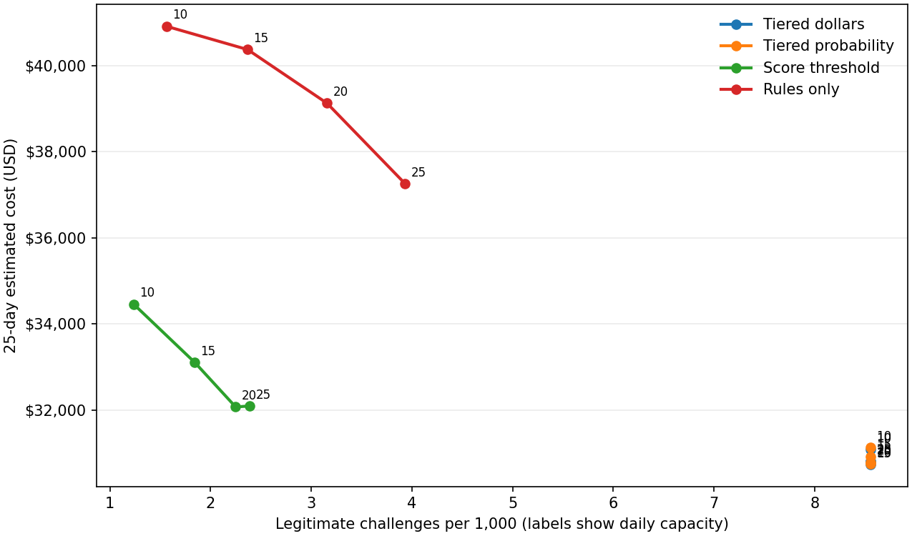

# Credit Card Fraud Strategy Simulator

[Open the live dashboard](https://shraoshree-fraud-strategy.streamlit.app/)

**At 100 review slots per day, tiered verification is cheaper below about $3.44 per legitimate challenge. Above $3.44, score-only review is cheaper.** At the $2 baseline, tiered review with verification saves an estimated **$1,332** versus score-only review, while raising legitimate challenges from **2.47 to 8.56 per 1,000**. The paired 95% bootstrap range is **−$59 to $2,805**. Dollar and probability ranking tie at this capacity because eligible reviews peak at 39 per day.



The synthetic holdout contains **226 fraud cases in 152,259 transactions (0.148%)**. The generator targets a low-prevalence scenario and increases the incident rate in the holdout. These are scenario assumptions. Actual incidence, verification yield, and friction tolerance depend on the portfolio.

## Run the dashboard

Use Python 3.11 or 3.12.

```sh
python -m pip install -r requirements.txt
python -m streamlit run app.py
```

The app uses committed aggregate scenario results and starts without model training or credentials. To regenerate the results from the fixed seed, run `python pipeline.py`. Run the tests with `python -m unittest discover -s tests -v`.

## Follow the analysis

| Step | Files | What to look for |
|---|---|---|
| Generate data | [pipeline.py](pipeline.py) | 90 days of transactions, low fraud incidence and a shift on day 66. |
| Build SQL features | [features.sql](sql/features.sql) | Prior-hour activity, spend relative to a 30-day card average, time since the previous transaction and first observed category. Same-second events are excluded from history. |
| Compare models | [model results](results/model_comparison.csv), [calibration](results/calibration.csv) | Days 1–30 warm up history, 31–50 train, 51–65 select model and thresholds, and 66–90 evaluate. Logistic regression won on validation average precision. |
| Compare policies | [policy.py](policy.py), [policy results](results/policy_comparison.csv), [bootstrap](results/bootstrap.csv) | Each model-based policy tunes its thresholds independently on validation. Tiered probability is the score-plus-verification baseline. A matched-threshold comparison isolates the effect of ranking. |
| Monitor outcomes | [monitoring.sql](sql/monitoring.sql), [daily results](results/daily_monitoring.csv) | Track review and verification volume, alert precision and legitimate challenge rate after fraud labels mature. |
| Plan a pilot | [Decision memo](DECISION_MEMO.md), [sample-size calculator](pilot_power.py) | Set guardrails, sample size and stopping rules before launch. |

At 25 review slots per day, probability ranking led dollar ranking by about **$31**. This backtest gives little evidence that dollar ranking improves decisions. At 100 slots, the modeled lift over score-only review comes from adding verification to the same review queue.

### Calibration under drift

In the highest-scoring logistic regression decile, mean prediction and observed fraud moved from **0.68% vs. 0.71%** in validation to **0.76% vs. 1.14%** in holdout. Holdout average precision was **0.167** for logistic regression and **0.019** for histogram gradient boosting. The deciles are formed independently in each split. The divergence matters because dollar ranking multiplies risk by transaction amount.

### Cost and uncertainty

Total cost adds remaining fraud exposure, action costs, and assumed friction costs. The $3.44 crossover holds the action thresholds and all other assumptions fixed. Review and verification are assumed to prevent 90% and 65% of associated fraud dollars, respectively. The paired bootstrap resamples the same 25 holdout days for every policy and reports 10,000 replicates. Its intervals reflect day-to-day variability in this scenario and leave uncertainty in the synthetic generator and intervention assumptions outside the estimate. The queue is ranked in daily batches.
