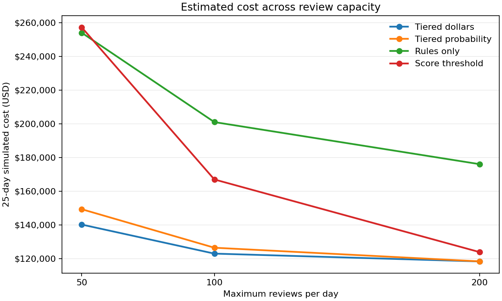

# Credit Card Fraud Strategy Simulator

**Recommendation for the simulated portfolio:** At 100 manual reviews per day, prioritize high-risk transactions by estimated fraud dollars and use verification for eligible overflow. Estimated cost fell from **$201,047 to $122,971 (38.8%)** versus rules alone over 25 days. Compared with a score-only policy, the recommended strategy challenged about **76 versus 23 legitimate transactions per 1,000**.



This independent portfolio project uses synthetic transactions and assumed intervention costs and effectiveness.

## Run locally

Use Python 3.11 or 3.12. On Windows PowerShell, activate the environment with `.venv\Scripts\Activate.ps1`.

```sh
python -m venv .venv
source .venv/bin/activate
python -m pip install -r requirements.txt
python pipeline.py
python -m unittest discover -s tests -v
python -m streamlit run app.py
```

The pipeline regenerates the sample outputs in `results/`. The dashboard uses the locally generated `scored.csv` and lets you vary daily review capacity, verification cost and effectiveness, and the cost of customer friction.

## Follow the workflow

| Step | Open | What to look for |
|---|---|---|
| 1. Generate transactions | [pipeline.py](pipeline.py) | A fixed seed generates 90 days of fictional card transactions, including bursts on the same card. A higher simulated incident rate starts on day 66. |
| 2. Analyze in SQL | [segments.sql](sql/segments.sql) and [features.sql](sql/features.sql) | Compare fraud rate and dollars by channel and category. Count previous transactions on a card within one hour, excluding the current timestamp. |
| 3. Estimate risk | [pipeline.py](pipeline.py) | Fit logistic regression on days 1–50. Choose two thresholds using days 51–65 and evaluate on days 66–90. |
| 4. Compare decisions | [policy.py](policy.py) | Apply four policies on the same holdout, each with the same daily review cap. |
| 5. Read the recommendation | [Decision memo](DECISION_MEMO.md) | See when lower losses justify extra friction and what to validate before a pilot. |
| 6. Change one assumption | [app.py](app.py) | Set the extra cost per legitimate challenge to $20 at 100 reviews per day and see which policy wins. |

The model's average precision was 0.401 at a 3.24% holdout fraud rate. Average precision summarizes the model's ability to rank fraud cases ahead of legitimate transactions. Policy selection uses estimated cost and friction.

## How policies route transactions

- **Rules only** reviews the largest eligible transactions. Eligibility requires an online purchase of at least $150 or two prior transactions on the same card in the last hour.
- **Score threshold** reviews the highest-risk transactions scoring at least 5%.
- **Tiered probability** reviews eligible transactions in order of fraud probability. Transactions scoring at least 4% that miss review receive verification.
- **Tiered dollars** uses the same tiers and ranks the review queue by fraud probability × amount.

Rules-only and score-only overflow is approved. Each strategy uses the same daily cap and the same cost assumptions. The shared model thresholds were selected by minimizing tiered-dollar validation cost at 100 reviews per day, so the score-only baseline is a fixed-threshold benchmark. Daily ranking assumes a batch queue and can see all eligible transactions for that day.

## Results files

- [Policy results](results/policy_comparison.csv) across three review limits
- [Verification sensitivity](results/sensitivity.csv) at 100 reviews per day
- [Segment analysis](results/segments.csv) across the full synthetic dataset
- [Model metrics and thresholds](results/metrics.json) for the reported run
